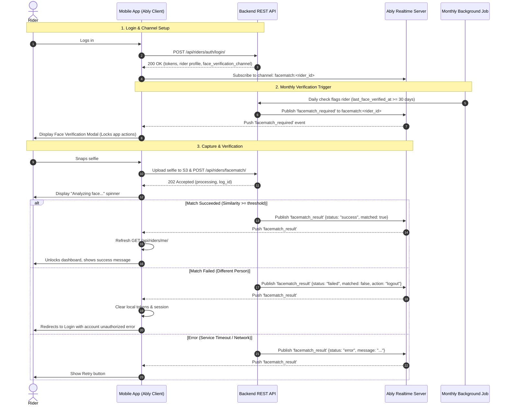

# Mobile Implementation Guide: Independent Rider Face Verification

This document provides complete instructions for the mobile engineering team (Flutter / React Native) to implement the **Independent Rider Monthly Face Verification** system.

---

## 1. Overview & Architecture

Independent riders must undergo face verification periodically (monthly rolling 30-day window) to ensure identity security and platform compliance.

The workflow is **event-driven via Ably Realtime**:
1. Upon **Login**, the mobile app receives the rider's dedicated Ably face verification channel (`facematch:<rider_id>`) and subscribes to it.
2. A backend **monthly background job** flags riders due for verification, deauthorizes order assignments (`is_authorized = false`), and broadcasts a real-time `facematch_required` event over Ably.
3. The mobile app displays a mandatory **Face Verification Prompt**, opens the camera for a selfie snapshot, and uploads the image.
4. The mobile app posts the selfie URL to `POST /api/riders/facematch/` (`202 Accepted`).
5. The backend compares the selfie against the KYC profile photo and pushes a `facematch_result` event over Ably.
6. The mobile app handles the result (unlocks account on success, or forces logout on mismatch).



---

## 2. API Endpoints & Payloads

### A. Rider Login
**Endpoint:** `POST /api/riders/auth/login/`

**Response (`200 OK`):**
```json
{
  "success": true,
  "message": "Login successful!",
  "tokens": {
    "access": "eyJhbGciOiJIUzI1Ni...",
    "refresh": "eyJhbGciOiJIUzI1Ni..."
  },
  "face_verification_channel": "facematch:RD1234",
  "channels": {
    "face_verification": "facematch:RD1234"
  },
  "rider": {
    "id": "e44c6883-93cf-42e5-a6e5-...",
    "rider_id": "RD1234",
    "status": "offline",
    "firstName": "John",
    "lastName": "Doe",
    "is_independent_rider": true,
    "is_verified": true,
    "face_verification_channel": "facematch:RD1234",
    "face_verification_required": false,
    "last_face_verified_at": "2026-09-25T14:30:00Z"
  }
}
```

> **Note for Non-Independent Riders:** For fleet/company riders (`is_independent_rider: false`), `face_verification_channel` will be `null`. Only subscribe to Ably if `face_verification_channel` is present.

---

### B. Current Rider Profile
**Endpoint:** `GET /api/riders/me/`  
**Headers:** `Authorization: Bearer <access_token>`

**Response (`200 OK`):**
```json
{
  "success": true,
  "data": {
    "id": "e44c6883-93cf-42e5-a6e5-...",
    "rider_id": "RD1234",
    "is_independent_rider": true,
    "is_verified": true,
    "face_verification_channel": "facematch:RD1234",
    "face_verification_required": false,
    "last_face_verified_at": "2026-09-25T14:30:00Z"
  }
}
```

> **Important UI Guard:**  
> If `face_verification_required == true` upon login or when refreshing `/api/riders/me/`, the mobile app must **immediately display the Face Verification Screen** and prevent the rider from going online or accepting orders until verified.

---

### C. Submit Face Match Selfie
**Endpoint:** `POST /api/riders/facematch/` (or `POST /api/riders/face-match/`)  
**Headers:** `Authorization: Bearer <access_token>`  
**Content-Type:** `application/json`

**Request Body:**
```json
{
  "image_url": "https://storage.aexpress.com/selfies/RD1234_snapshot_1730000000.jpg"
}
```

**Response (`202 Accepted`):**
```json
{
  "status": "success",
  "message": "Face match verification initiated.",
  "data": {
    "log_id": "0df6b88b-f286-4bb6-b1ea-271d1844b2f1",
    "channel": "facematch:RD1234",
    "event": "facematch_result",
    "status": "processing"
  }
}
```

---

### D. Get Face Verification History (Optional / Profile Screen)
**Endpoint:** `GET /api/riders/facematch/logs/?page=1&page_size=20`  
**Headers:** `Authorization: Bearer <access_token>`

**Response (`200 OK`):**
```json
{
  "status": "success",
  "message": "Face match logs retrieved successfully.",
  "data": {
    "count": 3,
    "page": 1,
    "page_size": 20,
    "results": [
      {
        "id": "0df6b88b-f286-4bb6-b1ea-271d1844b2f1",
        "rider_id": "RD1234",
        "rider_name": "John Doe",
        "trigger_type": "monthly_cron",
        "status": "success",
        "similarity": 97.4,
        "is_match": true,
        "selfie_url": "https://storage.aexpress.com/selfies/RD1234_snapshot.jpg",
        "reference_photo_url": "https://storage.aexpress.com/docs/profile.jpg",
        "error_message": "",
        "created_at": "2026-10-26T10:00:00.000000Z",
        "updated_at": "2026-10-26T10:01:15.000000Z"
      }
    ]
  }
}
```

---

## 3. Real-Time Ably Events Specification

### Channel Name: `facematch:<rider_id>`
*(Example: `facematch:RD1234`)*

---

### Event 1: `facematch_required`
Published by the backend background job when the rider is due for verification.

```json
{
  "action": "face_verification_required",
  "rider_id": "RD1234",
  "log_id": "0df6b88b-f286-4bb6-b1ea-271d1844b2f1",
  "due_date": "2026-10-26T10:00:00.000000+00:00",
  "reason": "monthly_verification"
}
```

**Mobile Action:**
1. Play notification sound / haptic vibration.
2. Present a non-dismissible modal or navigate to `/face-verification`.
3. Display message: *"Monthly Security Check: Please verify your face to continue receiving deliveries."*

---

### Event 2: `facematch_result`
Published by the backend after comparing the selfie with the KYC document.

#### Case A: Match Succeeded
```json
{
  "status": "success",
  "matched": true,
  "similarity": 96.5,
  "message": "Face match verification successful."
}
```
**Mobile Action:**
1. Hide spinner and show green success checkmark.
2. Toast: *"Identity verified successfully!"*
3. Refresh rider profile (`GET /api/riders/me/`).
4. Re-enable the "Go Online" toggle button and dismiss modal after 1.5s.

---

#### Case B: Match Failed (Deauthorization / Logout)
```json
{
  "status": "failed",
  "matched": false,
  "similarity": 28.3,
  "action": "logout",
  "message": "Face match verification failed. Your account has been unauthorized."
}
```
**Mobile Action:**
1. Show error dialog: *"Face verification failed. The captured selfie did not match your registered profile photo. Contact support if you need assistance."*
2. Clear stored JWT tokens (`access`, `refresh`) and user session from secure storage.
3. Unsubscribe from Ably channels.
4. Redirect rider to the Login screen.

---

#### Case C: Service Error (Connection / Timeout)
```json
{
  "status": "error",
  "matched": false,
  "message": "Failed to download face images: Connection timeout"
}
```
**Mobile Action:**
1. Display error banner with the message.
2. Show a **"Try Again"** button so the rider can retake their selfie.

---

## 4. Mobile Implementation Code Snippets

### A. Flutter (Dart) Implementation Example

```dart
import 'dart:convert';
import 'package:ably_flutter/ably_flutter.dart' as ably;
import 'package:http/http.dart' as http;

class FaceVerificationService {
  final String baseUrl = "https://api.aexpress.com";
  ably.Realtime? _ablyClient;
  ably.RealtimeChannel? _faceChannel;

  /// Call this after successful rider login
  Future<void> initializeAblyChannel({
    required String apiKey,
    required String channelName,
    required Function(Map<String, dynamic>) onVerificationRequired,
    required Function(Map<String, dynamic>) onVerificationResult,
  }) async {
    final clientOptions = ably.ClientOptions(key: apiKey);
    _ablyClient = ably.Realtime(options: clientOptions);

    _faceChannel = _ablyClient!.channels.get(channelName);
    await _faceChannel!.attach();

    // 1. Listen for Verification Required prompt from Background Cron
    _faceChannel!.subscribe(name: 'facematch_required').listen((message) {
      if (message.data != null) {
        final data = message.data is String 
            ? jsonDecode(message.data as String) 
            : Map<String, dynamic>.from(message.data as Map);
        onVerificationRequired(data);
      }
    });

    // 2. Listen for Verification Result after selfie submission
    _faceChannel!.subscribe(name: 'facematch_result').listen((message) {
      if (message.data != null) {
        final data = message.data is String 
            ? jsonDecode(message.data as String) 
            : Map<String, dynamic>.from(message.data as Map);
        onVerificationResult(data);
      }
    });
  }

  /// Submit selfie image URL to backend
  Future<bool> submitSelfie({
    required String accessToken,
    required String imageUrl,
  }) async {
    final url = Uri.parse('$baseUrl/api/riders/facematch/');
    final response = await http.post(
      url,
      headers: {
        'Content-Type': 'application/json',
        'Authorization': 'Bearer $accessToken',
      },
      body: jsonEncode({'image_url': imageUrl}),
    );

    return response.statusCode == 202;
  }

  void dispose() {
    _faceChannel?.detach();
    _ablyClient?.close();
  }
}
```

---

### B. React Native (TypeScript) Implementation Example

```typescript
import * as Ably from 'ably';

export class FaceVerificationService {
  private client: Ably.Realtime | null = null;
  private channel: Ably.RealtimeChannel | null = null;

  init(
    apiKey: string,
    channelName: string,
    onPrompt: (payload: any) => void,
    onResult: (payload: any) => void
  ) {
    this.client = new Ably.Realtime({ key: apiKey });
    this.channel = this.client.channels.get(channelName);

    // Listen for background trigger
    this.channel.subscribe('facematch_required', (message) => {
      onPrompt(message.data);
    });

    // Listen for verification outcome
    this.channel.subscribe('facematch_result', (message) => {
      onResult(message.data);
    });
  }

  async submitSelfie(token: string, imageUrl: string): Promise<boolean> {
    const response = await fetch('https://api.aexpress.com/api/riders/facematch/', {
      method: 'POST',
      headers: {
        'Content-Type': 'application/json',
        Authorization: `Bearer ${token}`,
      },
      body: JSON.stringify({ image_url: imageUrl }),
    });

    return response.status === 202;
  }

  cleanup() {
    if (this.channel) this.channel.unsubscribe();
    if (this.client) this.client.close();
  }
}
```

---

## 5. UI / UX Best Practices for Mobile

1. **Selfie Capture Quality Guidelines**:
   - Camera preview should display an oval face guide.
   - Enforce good lighting, neutral background, no sunglasses or masks.
   - Compress the image before uploading to S3 (recommended: JPEG, quality 85%, ~1080x1080px).
2. **Graceful Reconnection**:
   - If the mobile app is in the background when `facematch_required` is published, the app will also see `face_verification_required == true` when it calls `GET /api/riders/me/` on resume.
   - Check `rider.face_verification_required` whenever the app returns from background to foreground.
3. **Prevent Bypass**:
   - If `face_verification_required == true`, disable:
     - Duty toggle switch ("Go Online").
     - Offer acceptance buttons.
     - Wallet withdrawal buttons.

---

## 6. Verification & Testing Checklist

- [ ] Log in as an independent rider -> confirm `face_verification_channel` is received (`facematch:<rider_id>`).
- [ ] Connect to Ably on app launch and subscribe to `facematch:<rider_id>`.
- [ ] Simulate background job trigger using management command:  
  `python manage.py trigger_monthly_face_verification --rider-id <rider_id>`  
  -> Confirm mobile receives `facematch_required` and displays the prompt modal.
- [ ] Take selfie snapshot -> upload to S3 -> call `POST /api/riders/facematch/` -> confirm `202 Accepted` is received.
- [ ] Confirm mobile receives `facematch_result` (`matched: true`) -> verify modal dismisses and `is_verified` becomes `true`.
- [ ] Test failure scenario (snap non-matching face) -> verify mobile receives `facematch_result` (`matched: false, action: "logout"`) and redirects to Login.
